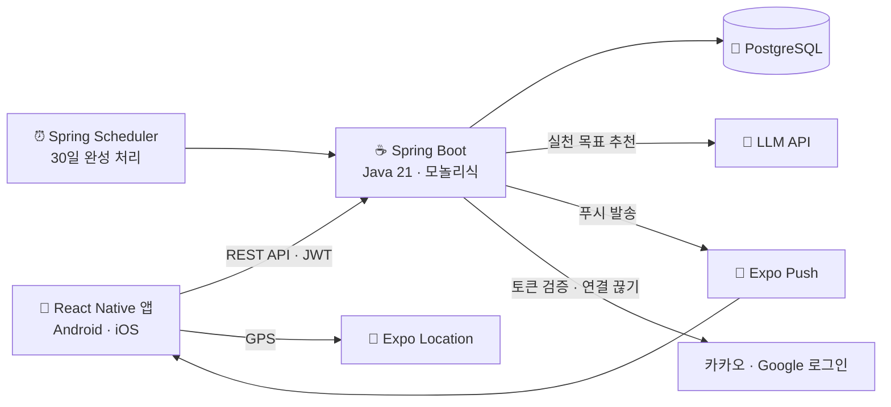
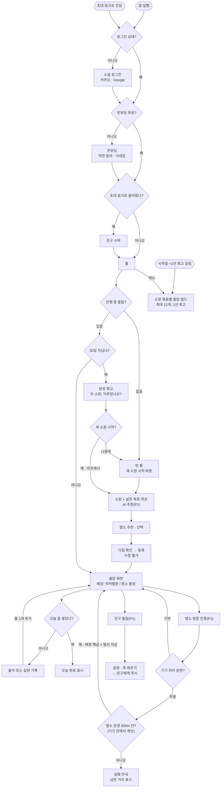

# 기능명세서

> 상태: 10/22 업데이트 초안 (10/23 수정 반영) · 우선순위: P0 = 필수 구현 · P1 = 추가 구현 · P2 = 여유 있을 때
> 🟡 표시는 팀 결정이 필요한 항목
> 원본: Notion "기능명세서" (이 파일은 복사본이므로, 큰 변경이 있으면 원본에서 다시 내보내세요)

## 서비스 구조 다이어그램

### 시스템 구조

### 기능 흐름

## 기능 목록

| ID | 기능 | 상세 | P |
| --- | --- | --- | --- |
| AUTH-01 | 소셜 로그인 | 카카오 + Google (10/27 Apple 제외). 최초 로그인 시 자동 가입, Access/Refresh Token 발급 | P0 |
| AUTH-02 | 온보딩 | 첫 로그인 시 이용약관·개인정보(필수) 동의 + 닉네임 설정. 완료 전엔 다른 기능 사용 불가 | P0 |
| AUTH-03 | 토큰 재발급·로그아웃 | Refresh Token으로 재발급(재발급 시 교체), 로그아웃 시 폐기 | P0 |
| AUTH-04 | 내 정보 | 닉네임, 프로필, 동의 현황, 푸시 토큰 등록 | P0 |
| AUTH-06 | 회원 탈퇴 | 즉시 삭제. 소셜 연결 끊기 → 토큰 폐기 → 본인 데이터·친구 관계·작성 응원 삭제 | P0 |
| HOME-01 | 홈 | 홈 = 돌탑 화면(11/2). 진행 중 돌탑이 있으면 홈에서 바로 오늘의 돌을 끌어 쌓기, 없으면 빈 홈(첫 돌 놓기 → 새 소원). 친구 돌탑 맛보기. 하단 탭(홈·명소·친구·모아보기), 우상단 알림·내 정보 (11/4) | P0 |
| WISH-01 | 소원 + 실천 목표 작성 | 소원 1개 + 구체적 실천 목표 (예: 매일 영어 단어 20개) | P0 |
| WISH-02 | AI 실천 목표 추천 | 막연한 소원 → 실천 목표 후보 3개. 타임아웃 5초, 1인 하루 10회, 실패 시 기본 추천 문구 | P1 |
| WISH-03 | 다짐 확인 & 등록 | 소원 재확인 + 다짐 문구 → 등록. 이후 수정·취소 불가. 진행 중 돌탑 1개 🟡 | P0 |
| WISH-04 | 공개 범위 | 비공개 / 친구 공개 (이후 변경 가능). 기본값은 비공개 🟡 | P1 |
| WISH-05 | 다짐 기간 | 초기 2주, 의미 확정 후 정의 🟡 | P1 |
| SPOT-01 | 명소 선택 | 카카오 지도에서 명소를 둘러보고 선택 (누르면 확대·설명, 좌우 화살표로 이동, "이 명소로 정하기", 11/4). 시드 10곳 | P0 |
| SPOT-02 | 명소 지도 | 카카오 지도로 명소 표시, 선택 화면과 같은 방식. 방문한 곳은 별표 (11/4) | P0 |
| SPOT-03 | 방문 인증 | 앱이 기기 안에서 명소 반경(500m) 안인지 계산하고, 서버에는 인증 결과만 전송. 좌표·거리·위치 동의는 서버로 보내거나 저장하지 않음 (11/5). 인증한 명소는 돌탑 전후와 상관없이 해금 | P1 |
| SPOT-04 | 특별 디지털 엽서 | 인증 시 명소별 엽서/포스터 지급, 보관함·이미지 저장 | P1 |
| STONE-01 | 오늘의 돌 | 하루 최대 1개 (KST). 출석 또는 실천 기록으로 쌓임 | P0 |
| STONE-02 | 돌탑 화면 | 아래부터 쌓이는 시각화, 맨 아래 돌에 소원 문구. 배경 = 방문: 명소 일러스트 / 미방문: 기본 화면 (11/5 변경, 친구 돌탑도 같음). 오늘 쌓으면 저녁 하늘 | P0 |
| STONE-03 | 다짐·응원 문구 | 돌 쌓을 때 문구 노출 (프론트 고정) | P1 |
| TOWER-01 | 30일 완성 | 스케줄러가 end_date 지난 돌탑 완성 처리 + 알림 | P0 |
| TOWER-02 | 완성 회고 | "이 소원, 이루었나요?" + 한 줄 회고 → 리프레시. 돌 30개 완성 / 일부만 쌓은 경우 연출 구분 🟡 | P0 |
| TOWER-03 | 돌탑 모아보기 | 첫 돌탑 시작일부터 1년 = 소원 묶음 1개("첫 번째 소원"), 완성일 기준 배정 (최대 12개). 필드 → 돌탑을 누르면 큰 카드 → 카드의 돌탑을 누르면 30일 회고 | P0 |
| TOWER-04 | 1년 회고 | 첫 시작일 +1년마다 알림 → 해당 묶음 모아보기로 이동. "나는 어떤 사람이 되었나요?" 200자, 12개를 못 채워도 쓸 수 있고(돌탑 없는 묶음 제외) 쓴 뒤 수정 불가. 회고를 볼 때 그 1년 동안 방문한 명소의 일러스트와 방문일을 함께 볼 수 있음 | P1 |
| FRIEND-01 | 친구 추가 | https 초대 링크 (설치 시 앱, 미설치 시 스토어), 인원 제한 없음 | P1 |
| FRIEND-02 | 친구 돌탑 보기 | 친구 공개 돌탑만 | P1 |
| FRIEND-03 | 응원 메시지 | 100자, 작성 시 푸시 | P1 |
| FRIEND-04 | 콕 찌르기 | 오늘 안 쌓은 친구에게 푸시, 같은 친구 하루 1회 | P1 |
| FRIEND-05 | 익명 소원지기 | 1명만, 매칭 방식 미정 🟡 | P2 |
| NOTI-01 | 알림 | 앱 내 알림함 + Expo 푸시 | P1 |
| DEMO-01 | 시간 가속 | 서버 시계 N일 이동 (시연 전용) | P0 |
| DEMO-02 | 위치 인증 우회 | 시연 모드 앱에서 반경 확인을 건너뜀 (위치 계산이 앱으로 옮겨 감, 11/5). 시연장은 명소 반경 밖이라 방문 인증·배경 해금·엽서 지급을 보여주기 위해 필요 | P0 |

## 미결정 🟡

- 다짐 기간 2주 의미 · 진행 중 돌탑 개수 · 익명 소원지기 매칭 · 명소 카테고리 기준

추가 검토 (10/23):
1. 방문 인증(SPOT-03)·디지털 엽서(SPOT-04) P0 승격 여부 — STONE-02(P0)의 명소 풍경 배경이 SPOT-03(P1)에 의존
2. ~~Apple 로그인 범위~~ → 10/27 결정: Apple 제외, 카카오 + Google
3. "소원 좁히기" 단계 유지 여부 (구버전에 있었으나 현재 명세에 없음)
4. 소원 등록 전 방문 / 소원 성취 후 방문 흐름
5. 돌 일부만 쌓은 탑의 완성 연출
